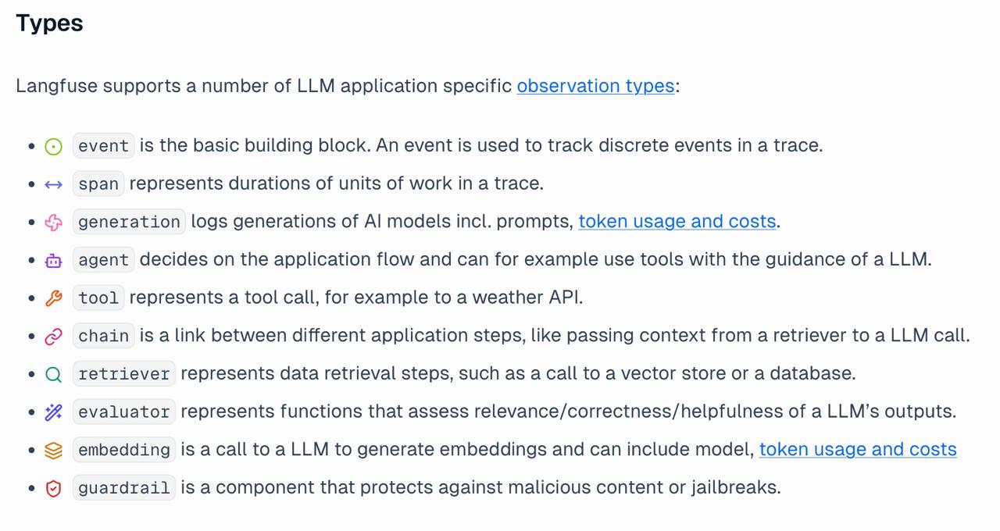

# Инструкция по интеграции Langfuse

## 1. Настройка окружения

Добавьте в файл `.env` следующие переменные:

```
LANGFUSE_SECRET_KEY =
LANGFUSE_PUBLIC_KEY =
LANGFUSE_BASE_URL = "http://178.253.40.72:3000"

PROJECT_NAME = 'project_name'
PROMPTS_DIR = '.../prompts'

LANGFUSE_ENABLED = True
LANGFUSE_TIMEOUT = 30
```

**Описание переменных:**
- `LANGFUSE_SECRET_KEY` и `LANGFUSE_PUBLIC_KEY` - ключи для доступа к Langfuse
- `LANGFUSE_BASE_URL` - адрес сервера Langfuse
- `PROJECT_NAME` - название вашего проекта (используется для группировки промптов и трейсов)
- `PROMPTS_DIR` - путь к директории с промптами в формате YAML
- `LANGFUSE_ENABLED` - включить/выключить логирование (True/False)
- `LANGFUSE_TIMEOUT` - таймаут для запросов к Langfuse

## 2. Базовое подключение для LangGraph - 5 минут

Для отслеживания выполнения графа LangGraph можно использовать `CallbackHandler`:

```python
from langfuse.langchain import CallbackHandler

langfuse_handler = CallbackHandler(update_trace=True)  # update_trace=True обязательно

def create_graph():
    workflow = StateGraph(YourState)

    # ... добавление нод и рёбер ...

    return workflow.compile().with_config(
        {
            "callbacks": [langfuse_handler],
            "run_name": "sberpravo-law", # название пайплайна/агента. Можно использовать PROJECT_NAME из окружения
            "metadata": {
                "langfuse_tags": ["sberpravo-law"],
                "langfuse_user_id": "Name",  # идентификатор для фильтрации своих трейсов
                "langfuse_environment": "dev",  # опционально: dev/prod
            },
        }
    )
```

**Важно:** Параметр `update_trace=True` в `CallbackHandler` обязателен для корректной работы.

## 3. Детализация и отслеживание отдельных нод/функций

Чтобы указать, какие поля из State использовать при отслеживании, можно использовать декоратор `@span`:

```python
from src.infrastructure.langfuse.integration import span

@span(
    as_type="generation",
    name="classify_law",
    in_keys=["classification_input"],
    out_keys=["intent_category"],
    prompt_name="classify_law",
)
def classify_law_node(state):
    # ваша логика
    return {"intent_category": result}
```

**Параметры декоратора `@span`:**

- `as_type` - тип шага

- `name` - имя ноды для отображения в интерфейсе Langfuse

- `in_keys` - список ключей из State, которые используются в ноде. Логируются как input. *Можно не указывать, тогда будут переданы все аргументы функции или State целиком*

- `out_keys` - список ключей из результата ноды (если возвращается dict/State). Логируются как output. *Можно не указывать, тогда будет передано все из return функции.*

- `prompt_name` - имя промпта, используемого в ноде. Указывается только для `as_type="generation"`. Промпт должен быть загружен в Langfuse. На первом этапе можно не указывать, добавить после загрузки промптов в Langfuse

**Доступные типы для as_type**



**Примеры использования:**

```python
# Для ноды без LLM
@span(
    as_type="span",
    name="preprocess_query",
    in_keys=["query"],
    out_keys=["processed_query"],
)
def preprocess_node(state):
    processed = state["query"].lower().strip()
    return {"processed_query": processed}

# Для ноды с LLM (без указания промпта на первом этапе)
@span(
    as_type="generation",
    name="generate_answer",
    in_keys=["query", "context"],
    out_keys=["answer"],
)
def answer_node(state):
    result = llm.invoke(prompt)
    return {"answer": result}
```

## 4. Работа с промптами

### 4.1. Формат промптов

Главная проблема - Langfuse использует формат `{{variable}}` для переменных в промптах (вместо стандартного `{variable}` для `.format()`), поэтому все промпты придется отредактировать.

**До:**
```python
prompt = "Классифицируй вопрос: {query}"
```

**После:**
```python
prompt = "Классифицируй вопрос: {{query}}"
```

### 4.2. Структура YAML файла промпта

Шаблон лежит рядом с инструкцией.

Создайте файл `prompt_name.yaml` в директории, указанной в `PROMPTS_DIR`:

```yaml
name: classify_law # лучше, если названия будут в формате задача_название: paraphrase_hyde, filter_segmets...
project: sberpravo-law
prompt:
  - role: system
    content: |
      Ты эксперт по законодательству.
      Классифицируй вопрос на категории.
  - role: user
    content: |
      {{query}}
config:
  some: thing # можно указать модель, параметры и что-нибудь еще полезное
labels:
  - production
  - latest
tags:
  - classification # для удобства. Если промптов в проекте много, можно добавить теги
version: 1 # можно не указывать, подставит автоматически
```

**Поля:**
- `name` - имя промпта (без `/`, проект указывается отдельно)
- `project` - название проекта (должно совпадать с `PROJECT_NAME`)
- `prompt` - содержимое промпта: список словарей с `role` и `content`
- `config` - дополнительная конфигурация
- `labels` - можно не указывать, подставит автоматически
- `tags` - теги для фильтрации
- `version` - версия промпта. Можно не указывать

**Альтернативный способ: создание через класс Prompt**

Вместо создания YAML файла вручную можно создать промпт через класс `Prompt` и сохранить его в файл:

```python
from src.infrastructure.langfuse.prompt_kit import Prompt

# Создание промпта
prompt = Prompt(
    name="classify_law",
    project="sberpravo-law",
    type="chat",
    prompt=[
        ("system", "Ты эксперт по законодательству.\nКлассифицируй вопрос на категории."),
        ("user", "{{query}}")
    ],
    config={"model": "gpt-9", "temperature": 0.7},
    labels=["production", "latest"],
    tags=["classification"],
    version=1
)

# Сохранение в файл
prompt.to_file()  # сохранит в PROMPTS_DIR/classify_law.yaml
# или с указанием пути
prompt.to_file(filepath="/path/to/prompts/classify_law.yaml")
```

Метод `to_file()` автоматически создаст YAML файл в правильном формате. Если файл уже существует, используйте `overwrite=True`:

```python
prompt.to_file(overwrite=True)
```

### 4.3. Загрузка промптов в Langfuse

После создания YAML файлов загрузите их в Langfuse. Есть два способа:

**Способ 1: Загрузка всех промптов из директории**

```python
from src.infrastructure.langfuse.prompt_kit import upload_prompts_to_langfuse

upload_prompts_to_langfuse(prompts_dir='/src/app/prompts')
```

Все промпты будут сохранены в Langfuse по пути `PROJECT_NAME/prompt_name`.

**Способ 2: Загрузка отдельного промпта через класс Prompt**

```python
from src.infrastructure.langfuse.prompt_kit import Prompt

prompt = Prompt(
    name="classify_law",
    project="sberpravo-law",
    type="chat",
    prompt=[
        ("system", "Ты эксперт по законодательству."),
        ("user", "{{query}}")
    ],
    labels=["production"],
    tags=["classification"]
)

# Отправка в Langfuse
prompt.send_to_langfuse()
```

Также можно загрузить промпт из файла и отправить:

```python
from src.infrastructure.langfuse.prompt_kit import get_prompt_from_file

prompt = get_prompt_from_file("classify_law")
prompt.send_to_langfuse()
```

### 4.4. Использование промптов в коде

Для получения промптов в коде - `promptstore`:

```python
from src.infrastructure.langfuse.prompt_kit import promptstore

# Загрузка промпта (автоматически из Langfuse или локального файла)
prompt = promptstore["classify_law"]

# Заполнение {{variables}}
compiled = prompt.compile(query="Какой срок давности?")

# Получение в нужном формате
prompt_text = compiled.format("string")  # для текстового - попробует переформатировать все в строку
prompt_messages = compiled.format("dict_list")  # для список словарей {'role': '', 'content': '..'}
prompt_langchain = compiled.format("langchain")  # для LangChain: HumanMessage, AssistantMessage, ...
```
По умолчанию промпт хранится в формате проектного коннектора
```python
from src.infrastructure.langfuse.prompt_kit import promptstore

prompt = promptstore["classify_law"]

# Заполнение {{variables}}
compiled = prompt.compile(query="Какой срок давности?")
prompt_tuples = prompt.prompt # -> [('role', 'content'), ('role', 'content'), ...]
```

`promptstore` - это словарь, который автоматически загружает промпты при первом обращении. Если `LANGFUSE_ENABLED=True`, промпты загружаются из Langfuse (с fallback на локальные файлы). Если `LANGFUSE_ENABLED=False`, промпты загружаются только из локальных файлов.

## 5. Использование без LangGraph

Если пайплайн не на LangGraph, используйте декоратор `@root` основной функции запуска пайплайна и `@span` на всем, что нужно отслеживать внутри:

```python
from src.infrastructure.langfuse.integration import root, span

@root(
    name="my_pipeline",
    static_tags=["pipeline"],
    static_metadata={"version": "1.0"},
)
def run_pipeline(query, user_id=None, session_id=None):
    # декоратор @root создаёт trace и прокидывает атрибуты
    result = process_query(query)
    return result

@span(
    as_type="generation",
    name="process_query",
    in_keys=["query"],
    out_keys=["result"],
)
def process_query(query):
    # логика обработки
    return {"result": answer}
```

**Параметры `@root`:**
- `name` - имя трейса (по умолчанию используется `PROJECT_NAME`)
- `static_tags` - список тегов для всех наблюдений в трейсе
- `static_metadata` - метаданные для трейса
- `get_user_id` - можно указать для идентификации своих трейсов
- `get_session_id` - если указать, будет объединять все трейсы в одну сессию. Можно использовать для диалогов. Значение - любое уникальное

## 6. Эксперименты и датасеты

Для работы с экспериментами и датасетами используйте клиент Langfuse:

```python
from src.infrastructure.langfuse.client import langfuse
from langfuse import Evaluation
import pandas as pd
```

### 6.1. Создание датасетов

**Создание датасета:**

```python
langfuse.create_dataset(
    name="my_dataset",
    description="Описание датасета",
    metadata={
        "author": "Alice",
        "date": "2022-01-01",
        "type": "benchmark"
    }
)
```

**Загрузка элементов датасета:**

Формат всегда `input` / `expected_output` / `metadata`, но в `input` и `expected_output` можно передавать словари.

```python
# Загрузка одного элемента
langfuse.create_dataset_item(
    dataset_name="my_dataset",
    input={
        "query": "Какой срок давности по административным правонарушениям?",
        "context": "КоАП РФ"
    },
    expected_output={
        "answer": "Срок давности составляет 2 года",
        "category": "административное право"
    },
    metadata={
        "source": "test_data",
        "difficulty": "medium"
    }
)
```

**Массовая загрузка элементов:**

```python
# Загрузка нескольких элементов из списка
items = [
    {
        "input": {"query": "Вопрос 1"},
        "expected_output": {"answer": "Ответ 1"},
        "metadata": {"id": 1}
    },
    {
        "input": {"query": "Вопрос 2"},
        "expected_output": {"answer": "Ответ 2"},
        "metadata": {"id": 2}
    }
]

for item in items:
    langfuse.create_dataset_item(
        dataset_name="my_dataset",
        input=item["input"],
        expected_output=item["expected_output"],
        metadata=item.get("metadata")
    )
```

**Загрузка из DataFrame:**

```python
import pandas as pd

df = pd.read_excel("test_data.xlsx")

for _, row in df.iterrows():
    langfuse.create_dataset_item(
        dataset_name="my_dataset",
        input={"query": row["question"]},
        expected_output={"answer": row["expected_answer"]},
        metadata={"id": row["id"]}
    )
```

Примеры готовых датасетов можно посмотреть в интерфейсе Langfuse: https://langfuse.gigalegal-rnd.ru

### 6.2. Работа с существующими датасетами

**Получение датасета:**

```python
# Получение датасета
dataset = langfuse.get_dataset('dataset_name')
dataset_items = dataset.items
```

**Обработка элементов датасета:**

```python
# Получение элементов датасета
for item in dataset_items:
    input_data = item.input
    expected_output = item.expected_output

    # Запуск пайплайна
    result = run_pipeline(input_data)

```

### 6.3. Прогоны на данных и автометрики

Для автоматической оценки качества пайплайна можно использовать эксперименты. Есть два способа: на датасетах из Langfuse и на локальных данных.

**Пайплайн:**

Перед запуском эксперимента нужно определить функцию, которая запускает ваш пайплайн на одном элементе данных. Функция должна принимать `item` (элемент данных) и возвращать результат работы пайплайна:


```python
def my_task(*, item, **kwargs):
    """
    Функция задачи для эксперимента.

    Args:
        item: Элемент данных. Для датасетов - объект с .input и .expected_output

    Returns:
        Результат работы пайплайна. Лучше идентичный формату expected_output
    """
    # Получение входных данных
    input_data = item.input

    # Для локальных данных
    #input_data = item['input']

    # Запуск пайплайна
    result = run_pipeline(input_data)

    return result
```

> Можно сначала прогонять пайплайн, чтобы не падать в процессе с ошибкой без сохраненных результатов, а потом в my_task просто доставать готовые результаты

**Пример предварительного прогона пайплайна:**

```python
from tqdm import tqdm

# Сначала прогоняем пайплайн и сохраняем результаты
results = {}
for item in tqdm(dataset_items, desc="Обработка данных"):
    url = item.input['url']
    try:
        results[url] = run_pipeline(url)
    except Exception as e:
        print(f'Error: {e}')
        results[url] = None

# Теперь просто достаем готовые результаты
def get_data(*, item, **kwargs):
    url = item.input['url']
    return results[url]

result = dataset.run_experiment(
    name="Оценка качества пайплайна",
    task=get_data)
```

**Запуск эксперимента на локальных данных:**

Можно запустить эксперимент напрямую без создания датасета:

```python
from src.infrastructure.langfuse.client import langfuse


def my_task(*, item, **kwargs):
    question = item["input"]

    result = run_pipeline(question)
    return result

# Локальные данные
local_data = [
    {"input": "Какой срок давности?", "expected_output": "2 года"},
    {"input": "Какая ответственность?", "expected_output": "Административная"},
]

result = langfuse.run_experiment(
    name="Оценка качества пайплайна",
    description="Тестирование на локальных данных",
    data=local_data,
    task=my_task,
    evaluators=[
        accuracy_evaluator,
    ],
)

# Просмотр результатов
print(result.format())
```

**Запуск эксперимента на датасете из Langfuse:**

Если данные уже загружены в датасет Langfuse, используйте `dataset.run_experiment()`:

```python
dataset = langfuse.get_dataset('my_dataset')

def my_task(*, item, **kwargs):
    input_data = item.input
    result = run_pipeline(input_data)
    return result

# Запуск эксперимента
experiment_results = dataset.run_experiment(
    name="Оценка качества пайплайна v1.0",
    description="Ежемесячная оценка production модели",
    task=my_task,
    evaluators=[
        accuracy_evaluator,
        keywords_recall_evaluator,
    ],
    run_evaluators=[
        average_accuracy_evaluator,
    ]
)
```


**Создание evaluators:**

Evaluator - это функция, которая сравнивает выход пайплайна с ожидаемым результатом. Функция должна принимать `input`, `output`, `expected_output` и возвращать объект `Evaluation`:

```python
from langfuse import Evaluation

def accuracy_evaluator(*, input, output, expected_output, metadata=None, **kwargs):
    """Оценка точности классификации"""
    pred = output or {}
    gold = expected_output or {}

    # Сравнение результатов
    match = pred.get('category') == gold.get('category')
    value = 1.0 if match else 0.0
    comment = f"pred={pred.get('category')}, gold={gold.get('category')}"

    return Evaluation(
        name="classification_accuracy",
        value=value,
        comment=comment
    )
```

**Run-level evaluators:**

Run-level evaluators вычисляют агрегированные метрики по всем элементам датасета, то есть операции над метриками из evaluators

```python
def average_accuracy_evaluator(*, item_results, **kwargs):
    """Вычисление средней точности по всем элементам"""
    accuracies = [
        eval.value for result in item_results
        for eval in result.evaluations
        if eval.name == "classification_accuracy"
    ]

    if not accuracies:
        return Evaluation(name="average_accuracy", value=None)

    avg = sum(accuracies) / len(accuracies)

    return Evaluation(
        name="Средняя точность классификации",
        value=avg
    )
```

**Запуск эксперимента на локальных данных:**

```python
from src.infrastructure.langfuse.client import langfuse

# Определение задачи
def my_task(*, item, **kwargs):
    """Запуск пайплайна на элементе данных"""
    input_data = item["input"]  # для локальных данных используется словарь
    result = run_pipeline(input_data)
    return result

# Локальные данные
local_data = [
    {"input": "Вопрос 1", "expected_output": "Ответ 1"},
    {"input": "Вопрос 2", "expected_output": "Ответ 2"},
]

# Запуск эксперимента
experiment_results = langfuse.run_experiment(
    name="Оценка качества пайплайна v1.0",
    description="Тестирование на локальных данных",
    data=local_data,
    task=my_task,
    evaluators=[
        accuracy_evaluator,
        keywords_recall_evaluator,
    ],
    run_evaluators=[
        average_accuracy_evaluator,
    ]
)

# Просмотр результатов
print(experiment_results.format())
```

**Запуск эксперимента на датасете из Langfuse:**

```python
# Определение задачи
def my_task(*, item, **kwargs):
    """Запуск пайплайна на элементе датасета"""
    input_data = item.input  # для датасетов используется .input
    result = run_pipeline(input_data)
    return result

# Получение датасета
dataset = langfuse.get_dataset('my_dataset')

# Запуск эксперимента
experiment_results = dataset.run_experiment(
    name="Оценка качества пайплайна v1.0",
    description="Ежемесячная оценка production модели",
    task=my_task,
    evaluators=[
        accuracy_evaluator,
        keywords_recall_evaluator,
    ],
    run_evaluators=[
        average_accuracy_evaluator,
    ]
)

# Просмотр результатов
print(experiment_results.format())
```

`run_experiment()`:
- Запускает `task` на каждом элементе данных
- Применяет все `evaluators` к результатам
- Вычисляет `run_evaluators` для агрегированных метрик
- Сохраняет все результаты в Langfuse
- Создает трейсы для каждого запуска пайплайна
